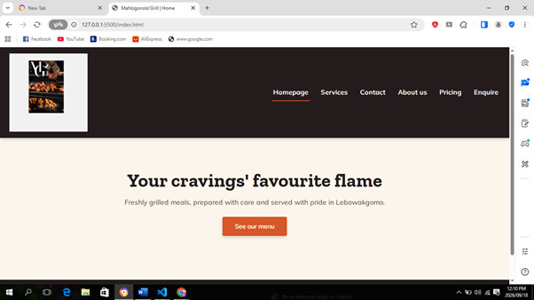
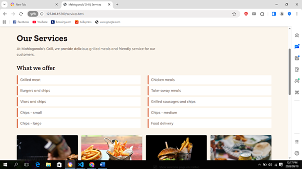
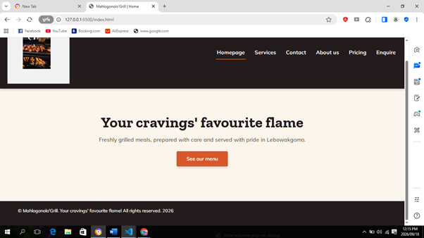

**Live site:** [https://mahlogonolo19.github.io/website/Mahlogonolo'Grill/index.html](https://mahlogonolo19.github.io/website/Mahlogonolo'Grill/index.html)

# Mahlogonolo'Grill Website

A multi-page website for Mahlogonolo'Grill, a local grill business based in
Lebowakgomo, Polokwane. The site was built for **WEDE5020 (Web Development —
Introduction)** as the Project Portfolio of Evidence.

## Description

Mahlogonolo'Grill serves grilled meat, chicken, burgers, wors, chips and
delivers to selected areas. The website gives customers an easy way to learn
about the business, view the menu and prices, and submit an enquiry or order.

## Features

- Six pages: Home, Services, About, Contact, Pricing, and Enquiry.
- Consistent header (logo + navigation) and footer across every page.
- A menu/services page listing all food and delivery offerings, with photos.
- A pricing page with a meal price table and a delivery-fee-by-area table.
- A contact page with phone, WhatsApp, email and address details.
- An enquiry form for customers to submit orders/questions online.
- External CSS stylesheet with a warm, food-themed colour palette.
- Fully responsive layout: desktop, tablet, and mobile breakpoints.

## Technologies Used

- HTML5 (semantic elements: `header`, `nav`, `main`, `section`, `footer`)
- CSS3 (Flexbox, CSS Grid, media queries, custom properties)
- Google Fonts (Zilla Slab for headings, Mulish for body text)
- Git & GitHub for version control

## File Structure

```
website/
└── Mahlogonolo'Grill/
    ├── index.html          Home page
    ├── about.html          About us page
    ├── services.html       Menu / services page
    ├── contact.html        Contact details page
    ├── pricing.html        Pricing tables page
    ├── enquiry.html        Customer enquiry form
    ├── style.css           External stylesheet (all pages)
    ├── _images/            Logo and photography used across the site
    └── README.md           This file
```

## Changelog

### Part 1 corrective actions (based on formative feedback, 74/100)

The following corrections address the specific criteria marked down in the
Part 1 feedback:

- **HTML Tags for Layout (was 5/10):** Replaced generic structure with
  proper HTML5 semantic elements — `<header>` (logo + nav), `<main>`
  (page content), and `<footer>` (copyright) — on every page, instead of
  unstructured content directly inside `<body>`.
- **Comments (was 0/5):** Added HTML comments throughout every page marking
  the header, navigation, main content sections, image credits, and footer,
  so the structure and purpose of each part of the code is documented.
- **README (was 2/5):** Rewrote this document to include a full project
  description, feature list, technologies used, file structure, changelog,
  and properly formatted references.
- **Changelog (was 0/5):** Added this Changelog section, documenting both
  the Part 1 corrections above and the Part 2 CSS/responsive work below.
- **References (was 2/5):** Rebuilt the reference list below in Harvard
  style, crediting every external resource and photograph used.

> Note: three criteria from the Part 1 feedback — Wireframes (1/2),
> Timeline (0/2), and Two Proposals (3/5) — relate to the written project
> proposal document rather than the website code, and are not addressed by
> this repository.

Also fixed while correcting the above:
- Broken `<nav>` markup on every page (the navigation list sat outside the
  `<nav>` element, with a stray unmatched closing tag).
- `arial-label` typo corrected to `aria-label` on every page.
- `about.html` was missing closing `</body></html>` tags and a footer.
- `enquiry.html`: the form was outside `<body>` and had a duplicate closing
  `</form>` tag; moved inside `<main>` and de-duplicated.
- `enquiry.html`: fixed a malformed `name` attribute on the Full Name input.
- `services.html`: moved gallery images out of the `<ul>` (images placed
  directly inside a list, not inside an `<li>`, are invalid HTML) into a
  separate gallery `<div>`.

### Part 2 — CSS Styling & Responsive Design

- Created an external stylesheet, `style.css`, linked in the `<head>` of
  every page.
- Established a base style: font family, colour palette, and a CSS reset
  applied site-wide.
- Applied typography styles (`font-family`, `font-size`, `font-weight`,
  `line-height`, `letter-spacing`) to headings and body text.
- Built the desktop layout with Flexbox (header/nav) and CSS Grid (menu
  list, photo gallery, enquiry form).
- Applied visual styling (`color`, `background-color`, `border`,
  `box-shadow`) and interactive states (`:hover`, `:focus`, `:active`) to
  nav links, the call-to-action button, and the enquiry form.
- Implemented responsive design with two breakpoints (900px tablet, 600px
  mobile), switching multi-column layouts to a single column on smaller
  screens.
- Used relative units (`rem`, `em`, `%`) instead of fixed pixels for font
  sizes, spacing and widths.
- Made all images responsive (`max-width: 100%; height: auto;`).
- Wrapped both pricing tables in a scrollable container so they don't
  break the layout on narrow screens.

## Screenshot Evidence

### Desktop





### Tablet





### Mobile




### Part 3 — JavaScript Enhancements
- Added a lightbox gallery (`script.js`) so visitors can click any food photo on the Services and About pages to view it enlarged, with a close button and Escape-key support.
- Added a live search/filter box on the Services page menu list, so visitors can type to instantly filter menu items.
- Added an FAQ accordion on the Contact page covering delivery areas, ordering, and payment methods, with expandable/collapsible answers.

### Part 3 — Forms & Validation
- Rebuilt the enquiry form (`enquiry.html`) with full JavaScript validation (name length, email format, phone number format, message length) and a confirmation response shown on successful submission.
- Added a new, separate contact form to `contact.html` for general messages, feedback, complaints, and partnership enquiries — distinct in purpose from the enquiry form.
- The contact form validates input, then compiles it into an email (name, email, message type, message) and opens the user's email client via a `mailto:` link addressed to info@mahlogonologrill.co.za.
- Added shared form error and response styling in `style.css`.

## SEO

### On-Page SEO
- Descriptive, keyword-relevant `<title>` and `<meta name="description">` tags on every page.
- Semantic header structure (`<h1>` once per page, `<h2>`/`<h3>` for sections).
- Descriptive, specific `alt` text on all images.
- Clean, readable URL structure (e.g. `services.html`, `pricing.html`).
- Internal linking via the consistent navigation menu on every page.
- Fully responsive, mobile-friendly layout (see Part 2).

### Off-Page SEO
- Recommended next steps for the business: list the site on Google Business Profile for local search visibility, share the site link on social media (Facebook/Instagram), and seek backlinks from local directories or food delivery platforms.

### Additional SEO Measures
- `robots.txt` and `sitemap.xml` added to guide search engine crawlers.
- `X-Content-Type-Options: nosniff` meta tag added to every page as a basic security measure.
- Lightweight CSS/JS and optimised image usage to support fast page load times.

### Part 3 — JavaScript Enhancements, Forms, SEO & Deployment

**JavaScript Enhancements**
- Added a lightbox gallery (`script.js`) so visitors can click any food photo on the Services and About pages to view it enlarged, with a close button, click-outside-to-close, and Escape-key support.
- Added a live search/filter box on the Services page menu list, letting visitors type to instantly filter menu items (dynamic content).
- Added an FAQ accordion on the Contact page (delivery areas, ordering, payment methods) with expandable/collapsible answers and smooth transitions.

**Forms & Validation**
- Rebuilt the enquiry form (`enquiry.html`) with full JavaScript validation (name length, email format, phone number format, message length) and a fixed confirmation response shown on successful submission.
- Added a new, separate contact form to `contact.html` for general messages, feedback, complaints, and partnership enquiries — distinct in purpose from the enquiry form, as required.
- The contact form validates input, then compiles it into an email (name, email, message type, message) and opens the user's email client via a `mailto:` link addressed to info@mahlogonologrill.co.za.
- Added shared form error and response styling in `style.css`.

**SEO**
- Added descriptive, keyword-relevant `<title>` and `<meta name="description">` tags to every page.
- Improved image `alt` text on the Services gallery to be more specific and descriptive.
- Added `robots.txt` and `sitemap.xml` to guide search engine crawlers.
- Added `X-Content-Type-Options: nosniff` meta tag to every page as a basic security measure.
- Confirmed existing semantic header structure, clean URLs, internal linking via the navigation menu, and mobile-friendly responsive layout all support on-page SEO.
- Documented recommended off-page SEO steps (Google Business Profile listing, social media promotion, local directory backlinks) for future implementation.

**Deployment**
- Deployed the site using GitHub Pages, live at: https://mahlogonolo19.github.io/website/Mahlogonolo'Grill/index.html
- Added a `.nojekyll` file at the repository root to ensure the `_images` folder (and other underscore-prefixed folders) publish correctly on GitHub Pages, since Jekyll processing ignores them by default.
- Added a redirect `index.html` at the repository root so the base site URL automatically forwards visitors to the actual homepage.

- Added an interactive Leaflet/OpenStreetMap map to the Contact page showing the grill's location with a clickable marker popup.
- Added `<meta name="keywords">` tags to every page with relevant, page-specific keywords.
- Added an interactive Leaflet/OpenStreetMap map to the Contact page showing the grill's location with a clickable marker popup.
- Added `<meta name="keywords">` tags to every page with relevant, page-specific keywords.

### Part 2 Feedback Corrections
Part 2 feedback scored 95/100. Marks were lost on two criteria, and both were addressed:

- **Feedback for Part 1 ("changelog detailed but could be improved"):** The earlier changelog grouped fixes together. It now records every fix per file, with what was wrong, what changed, and why:
  - `index.html`: the navigation list sat outside its `<nav>` tag, and the class was misspelled `nav-Link` instead of `nav-link`, so no CSS applied. Fixed both and added `aria-label` (was misspelled `arial-label`).
  - `about.html`: header and main were swapped (page text inside `<header>`, logo and menu inside `<main>`). Moved each back into its correct element.
  - `contact.html`: the header sat at the bottom of the page, after `<main>`, and the logo was missing. Moved it to the top and restored the logo.
  - `enquiry.html`: the form was outside `<body>`, there was a duplicate `</form>`, the Full Name input had a malformed `name` attribute, and the page title said "Home". Fixed all four.
  - `pricing.html`: the header sat at the bottom and held a food photo instead of the logo. Restored the logo, moved the photo into `<main>`, and wrapped both tables in a scrollable container.
  - `services.html`: the header sat at the bottom, and the gallery images were placed directly inside a `<ul>` (invalid HTML). Moved them into their own gallery `<div>`.
-- **References ("incorrectly formatted"):** Rewrote the reference list in the IIE Harvard (Anglia) style: Author, Year. Title. [online] Available at: <URL> [Accessed date]. Sources are in alphabetical order, photographs use the [photograph] format, missing years are shown as [s.a.], and in-text citations were added. The two missing photo credits and the Part 3 sources (Leaflet, OpenStreetMap, Google Search Central, MDN form validation, GitHub Pages) were added.
## References

## References

Anshu A, [s.a.]. Food photograph. [photograph] Available at: &lt;https://unsplash.com/photos/j03VKw-IflE&gt; [Accessed 31 October 2026].

Barrett, R., [s.a.]. Food photograph. [photograph] Available at: &lt;https://unsplash.com/photos/xmibn7mzXV0&gt; [Accessed 31 October 2026].

Connor, M., [s.a.]. Food photograph. [photograph] Available at: &lt;https://unsplash.com/photos/9Qs_9n2oSJo&gt; [Accessed 31 October 2026].

GitHub, [s.a.]. GitHub Pages documentation. [online] Available at: &lt;https://docs.github.com/en/pages&gt; [Accessed 31 October 2026].

Google Fonts, [s.a.]. Mulish. [online] Available at: &lt;https://fonts.google.com/specimen/Mulish&gt; [Accessed 31 October 2026].

Google Fonts, [s.a.]. Zilla Slab. [online] Available at: &lt;https://fonts.google.com/specimen/Zilla+Slab&gt; [Accessed 31 October 2026].

Google Search Central, [s.a.]. Introduction to robots.txt. [online] Available at: &lt;https://developers.google.com/search/docs/crawling-indexing/robots/intro&gt; [Accessed 31 October 2026].

Google Search Central, [s.a.]. Learn about sitemaps. [online] Available at: &lt;https://developers.google.com/search/docs/crawling-indexing/sitemaps/overview&gt; [Accessed 31 October 2026].

Jordan, [s.a.]. Food photograph. [photograph] Available at: &lt;https://unsplash.com/photos/N1NvJoqMg9g&gt; [Accessed 31 October 2026].

Ketz, Z., [s.a.]. Food photograph. [photograph] Available at: &lt;https://unsplash.com/photos/jffYxYP7L8Q&gt; [Accessed 31 October 2026].

Leaflet, [s.a.]. Leaflet quick start guide. [online] Available at: &lt;https://leafletjs.com/examples/quick-start/&gt; [Accessed 31 October 2026].

Mclean, E., [s.a.]. Food photograph. [photograph] Available at: &lt;https://unsplash.com/photos/xuT5ypEdf_g&gt; [Accessed 31 October 2026].

MDN Web Docs, [s.a.]. Client-side form validation. [online] Available at: &lt;https://developer.mozilla.org/en-US/docs/Learn_web_development/Extensions/Forms/Form_validation&gt; [Accessed 31 October 2026].

MDN Web Docs, [s.a.]. CSS flexible box layout. [online] Available at: &lt;https://developer.mozilla.org/en-US/docs/Web/CSS/CSS_flexible_box_layout&gt; [Accessed 31 October 2026].

MDN Web Docs, [s.a.]. CSS grid layout. [online] Available at: &lt;https://developer.mozilla.org/en-US/docs/Web/CSS/CSS_grid_layout&gt; [Accessed 31 October 2026].

MDN Web Docs, [s.a.]. Using media queries. [online] Available at: &lt;https://developer.mozilla.org/en-US/docs/Web/CSS/CSS_media_queries/Using_media_queries&gt; [Accessed 31 October 2026].

Mucha, M., [s.a.]. Food photograph. [photograph] Available at: &lt;https://unsplash.com/photos/a74X5kHDs20&gt; [Accessed 31 October 2026].

OpenStreetMap, [s.a.]. Copyright and license. [online] Available at: &lt;https://www.openstreetmap.org/copyright&gt; [Accessed 31 October 2026].

SK, [s.a.]. Food photograph. [photograph] Available at: &lt;https://unsplash.com/photos/uVPV_nV17Tw&gt; [Accessed 31 October 2026].

> Double-check each Unsplash link opens the correct photo before
> submitting, and fill in the actual date you accessed each source —
> your lecturer will check these are accurate and correctly formatted.

## Author

Mahlogonolo Mphahlele